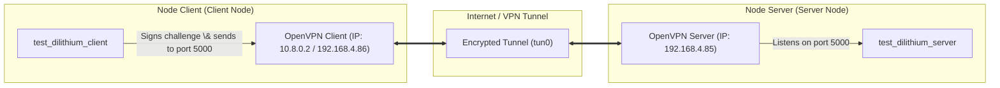

# Dilithium (Research Fork)

This repository is a fork of the upstream Dilithium implementation (pq-crystals/dilithium), customized for post-quantum cryptography (PQC) research and benchmarking. Dilithium is standardized as [FIPS 204](https://csrc.nist.gov/pubs/fips/204/final) (ML-DSA).

It contains:
- `ref/`: portable reference C implementation
- `avx2/`: optimized x86_64 implementation using AVX2
- `Dilithium_KAT/`: pre-generated NIST KAT request/response files
- `ref/test/`: TCP client/server demo + stress tool (POSIX/WSL)

For a list of changes in this fork, see [CHANGELOG.md](CHANGELOG.md).

---

## Table of Contents

- [Reproducibility Quick Start](#reproducibility-quick-start)
- [Build](#build)
- [Executable Files \& Their Functions](#executable-files--their-functions)
- [Correctness Tests](#correctness-tests)
- [Benchmarking (Cycle Counts)](#benchmarking-cycle-counts)
- [Deterministic Test Vectors](#deterministic-test-vectors)
- [NIST KAT Generator (Optional)](#nist-kat-generator-optional)
- [TCP Client/Server Demo \& OpenVPN Network Setup](#tcp-clientserver-demo--openvpn-network-setup)
- [Coverage (Optional)](#coverage-optional)
- [License](#license)

---

## Reproducibility Quick Start

### Platform Notes

- **Linux is recommended** for reproducible benchmarking.
- **macOS** builds the `ref/` implementation fine in most setups.
- **Windows**: Use **WSL2** for the simplest build/run workflow (the stress tool under `ref/test/` uses POSIX APIs such as `fork()`).
- `avx2/` requires an x86_64 CPU with **AVX2** instructions.

### Dependencies

Ubuntu/Debian:

```sh
sudo apt-get update
sudo apt-get install -y build-essential make pkg-config libssl-dev
```

Optional tools:

```sh
sudo apt-get install -y valgrind lcov
```

macOS (OpenSSL headers/libs may require flags):

```sh
brew install openssl
export CFLAGS="-I$(brew --prefix openssl)/include"
export NISTFLAGS="-I$(brew --prefix openssl)/include"
export LDFLAGS="-L$(brew --prefix openssl)/lib"
```

---

## Build

All commands below assume you are at the repository root.

### Reference Implementation (`ref/`)

Build correctness tests:

```sh
make -C ref clean
make -C ref all
```

This produces:
- `ref/test/test_dilithium2`
- `ref/test/test_dilithium3`
- `ref/test/test_dilithium5`

### AVX2 Implementation (`avx2/`)

Requires an x86_64 CPU with AVX2.

```sh
make -C avx2 clean
make -C avx2 all
```

This produces:
- Correctness: `avx2/test/test_dilithium2`, `avx2/test/test_dilithium3`, `avx2/test/test_dilithium5`
- Test vectors: `avx2/test/test_vectors2`, `avx2/test/test_vectors3`, `avx2/test/test_vectors5`
- Speed benchmarks: `avx2/test/test_speed2`, `avx2/test/test_speed3`, `avx2/test/test_speed5`

### TCP Client/Server \& Keygen (Under `ref/test/`)

To compile the TCP challenge-response network binaries and helper tools:

```sh
make -C ref/test clean
make -C ref/test all
```

This compiles all files for security modes 2, 3, and 5:
- Key generation: `test_dilithium_keygen2`, `test_dilithium_keygen3`, `test_dilithium_keygen5`
- TCP Server: `test_dilithium_server2`, `test_dilithium_server3`, `test_dilithium_server5`
- TCP Client: `test_dilithium_client2`, `test_dilithium_client3`, `test_dilithium_client5`
- Stress testing: `test_dilithium_stress2`, `test_dilithium_stress3`, `test_dilithium_stress5`

---

## Executable Files \& Their Functions

This section guides you through the roles and functionalities of all compiled executable binaries in the project:

### 1. TCP challenge-response Network Binaries (`ref/test/`)

| Executable | Purpose \& Detailed Behavior |
| :--- | :--- |
| `test_dilithium_keygen{2,3,5}` | **Keypair Generator**: Generates Dilithium public and private key pairs for security levels 2, 3, or 5. Saves them to three binary files in the working directory:<br>- `client_sk.bin` (Client's secret key, used for signing).<br>- `client_pk.bin` (Client's public key).<br>- `server_pk.bin` (Server's public key copy, used to verify the client's signature). |
| `test_dilithium_server{2,3,5}` | **TCP Verification Server**: Listens on TCP port `5000` (by default) for connections.<br>- On startup, it loads the public key from `server_pk.bin`.<br>- When a client connects, it loads a challenge payload from `test/input.txt` (or falls back to `input.txt` or a default string) and transmits it to the client.<br>- It waits for the client to return a signature, then verifies the signature using the loaded public key.<br>- Verification results, resource usage (CPU time, RSS memory), and timings are logged to `server.log`. |
| `test_dilithium_client{2,3,5}` | **TCP Signing Client**: Connects to the server's IP address on port `5000`. By default, it connects to `192.168.4.85`. <br>- On startup, it loads the private key from `client_sk.bin`.<br>- Receives the challenge payload from the server.<br>- Signs the challenge payload using Dilithium signature APIs (`crypto_sign`).<br>- Transmits the signature back to the server and logs network details to `client.log`. |
| `test_dilithium_stress{2,3,5}` | **Load \& Stress Testing Tool**: Spawns multiple concurrent client sessions using POSIX `fork()` to query the server simultaneously. By default, it connects to `192.168.4.85` with 10 concurrent sessions.<br>- Tests server concurrency, stability under load, and monitors memory/CPU overhead.<br>- Configurable via environment variables: `TARGET_IP`, `CONCURRENT_SESSIONS` (number of processes), `BATCHES` (number of runs), and `BATCH_DELAY_SEC` (delay between batches). |

### 2. Local Algorithm Testing Binaries

| Executable | Location | Description |
| :--- | :--- | :--- |
| `test_dilithium{2,3,5}` | `ref/test/` or `avx2/test/` | **Correctness Test**: Verifies the basic logic of the Dilithium algorithm locally (Keygen -> Sign -> Open/Verify) in memory. It serves as a sanity check to verify compilation without requiring a network. |
| `test_speed{2,3,5}` | `ref/test/` or `avx2/test/` | **Speed Benchmarking**: Executes key operations (Keygen, Sign, Verify) in a loop (1000 iterations) and prints average and median CPU cycle counts utilizing `RDTSC`. |
| `test_vectors{2,3,5}` | `ref/test/` or `avx2/test/` | **Deterministic Vector Generator**: Produces 10,000 sets of deterministic test vectors utilizing SHAKE128 as a pseudo-random seed generator. Outputs are matched against `SHA256SUMS` to verify compliance with specification standards. |
| `test_mul` | `ref/test/` or `avx2/test/` | **Polynomial Multiplication Benchmark**: Measures performance and correctness of NTT (Number Theoretic Transform) polynomial operations. |

---

## Correctness Tests

Verify implementation correctness locally:

Reference (`ref`):

```sh
./ref/test/test_dilithium2
./ref/test/test_dilithium3
./ref/test/test_dilithium5
```

AVX2:

```sh
./avx2/test/test_dilithium2
./avx2/test/test_dilithium3
./avx2/test/test_dilithium5
```

---

## Benchmarking (Cycle Counts)

The `test_speed*` programs print median and average CPU cycle counts (1000 iterations) using `RDTSC`.

Reference:

```sh
make -C ref speed
./ref/test/test_speed2
./ref/test/test_speed3
./ref/test/test_speed5
```

AVX2:

```sh
make -C avx2 speed
./avx2/test/test_speed2
./avx2/test/test_speed3
./avx2/test/test_speed5
```

---

## Deterministic Test Vectors

Generate deterministic vectors to verify against known SHA256 checksums:

```sh
# Compile vectors (not built by default in ref)
make -C ref test/test_vectors2 test/test_vectors3 test/test_vectors5

# Generate and verify checksums
./ref/test/test_vectors2 > tvecs2
./ref/test/test_vectors3 > tvecs3
./ref/test/test_vectors5 > tvecs5
sha256sum -c SHA256SUMS
```

*(On macOS, replace `sha256sum -c` with `shasum -a256 -c`)*.

---

## NIST KAT Generator (Optional)

Requires OpenSSL:

```sh
make -C ref nistkat
./ref/nistkat/PQCgenKAT_sign2
./ref/nistkat/PQCgenKAT_sign3
./ref/nistkat/PQCgenKAT_sign5
```

This writes `PQCsignKAT_*.req` / `PQCsignKAT_*.rsp` in the current directory.
Pre-generated KAT files are also stored under `Dilithium_KAT/`.

---

## TCP Client/Server Demo \& OpenVPN Network Setup

This guide walks you through setting up, connecting, and running a remote challenge-response session between a **Node Server** and a **Node Client** on different networks using **OpenVPN** to bridge the connection securely.

### Network Topology



### Step 1: Set Up OpenVPN Between the Nodes

If the nodes reside on different networks or behind strict NAT firewalls, use OpenVPN to map them into a shared Virtual Private Network (VPN). To use the default server IP of the codebase:

1. **On the Server Node (hosting the Server App)**:
   - Install and configure an OpenVPN server.
   - Configure OpenVPN to use IP routing (**TUN** mode).
   - Configure your OpenVPN server or local routing so the Server Node's virtual VPN interface gets assigned the IP **`192.168.4.85`** (the codebase's default target IP).
   - Ensure the server firewall allows incoming connections on port `5000` (for the TCP demo) and port `1194` (for OpenVPN).
   - Export a client configuration profile (e.g., `client1.ovpn`).

2. **On the Client Node (hosting the Client App)**:
   - Install the OpenVPN client package (`openvpn` or OpenVPN Connect).
   - Copy the `client1.ovpn` file from the Server Node onto the Client Node.
   - Establish the VPN tunnel:
     ```sh
     sudo openvpn --config client1.ovpn
     ```

3. **Verify Connectivity**:
   - Check that you can ping the Server Node from the Client Node: `ping 192.168.4.85`.

---

### Step 2: Build Network Binaries on Both Nodes

On both the Server and Client nodes, compile the network binaries under the test directory:

```sh
# Clean and compile client, server, stress, and keygen binaries
make -C ref/test clean
make -C ref/test all
```

---

### Step 3: Run Keypair Generator and Copy Public Key

To establish trust between the client and server, a keypair must be generated first.

On the **Client Node**, run the keygen binary (e.g., for Dilithium2):
```sh
cd ref/test
./test_dilithium_keygen2
```
*Note: No parameters are required.* This generates:
- `client_sk.bin` (Client Secret Key - remains on Client Node)
- `client_pk.bin` (Client Public Key - remains on Client Node)
- `server_pk.bin` (Server Verification Public Key - **must be copied to Server Node**)

Copy `server_pk.bin` from the Client Node to the `ref/test/` directory on the **Server Node** (e.g., via `scp` over the VPN link):
```sh
scp server_pk.bin user@192.168.4.85:/path/to/dilithium-dev/ref/test/
```

---

### Step 4: Run Server, Client, and Stress Test (No Parameters Needed)

Once the keys are in place and the Server Node is accessible at `192.168.4.85`, you can run the server, client, and stress test directly without specifying any IP parameters since `192.168.4.85` is the built-in default destination.

1. **On the Server Node**:
   ```sh
   cd ref/test
   ./test_dilithium_server2
   ```
   *Note: No parameters are required.* The server will automatically load `server_pk.bin` and listen on port `5000`.

2. **On the Client Node (Single Request)**:
   ```sh
   cd ref/test
   ./test_dilithium_client2
   ```
   *Note: No parameters are required.* The client automatically connects to the server at `192.168.4.85:5000`, receives the challenge, signs it, sends the signature back, and exits.

3. **On the Client Node (Concurrent Stress Test)**:
   ```sh
   cd ref/test
   ./test_dilithium_stress2
   ```
   *Note: No parameters are required.* By default, it spawns 10 concurrent processes targeting `192.168.4.85` and cycles indefinitely.

---

### Step 5: Customizing Stress Test (Optional Parameters)

If you wish to override the default settings (e.g. running on a different server IP, changing the number of concurrent sessions, or setting a run limit), pass them as environment variables:

```sh
cd ref/test
TARGET_IP=192.168.4.85 CONCURRENT_SESSIONS=50 BATCHES=5 BATCH_DELAY_SEC=1 ./test_dilithium_stress2
```

- `TARGET_IP`: Overrides the target server IP.
- `CONCURRENT_SESSIONS`: Spawns custom number of concurrent clients.
- `BATCHES`: Total execution batches (set to a number like `5` to auto-terminate after 5 batches; `0` runs indefinitely).
- `BATCH_DELAY_SEC`: Delay in seconds between batches.

---

## Network Protocol Details

The protocol is framed as follows:
1. **Server → Client**: `uint32_be length` followed by the raw challenge bytes.
2. **Client → Server**: `uint32_be length` followed by the raw signature bytes.

All logs and generated `.bin` keys are saved under `ref/test/`. You can override the client log destination using the `CLIENT_LOG_PATH` environment variable.

---

## Coverage (Optional)

Generate an lcov coverage report (Linux only):

```sh
./runlcov.sh
```

---

## License

See [LICENSE](LICENSE). This repository is available under CC0, Apache 2.0, or GPL 2.0. The NIST KAT generator sources under `ref/nistkat/` are provided by NIST.
